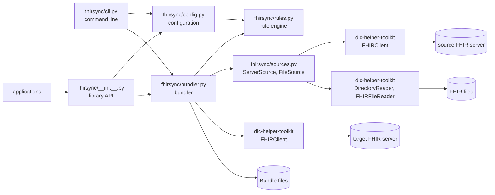
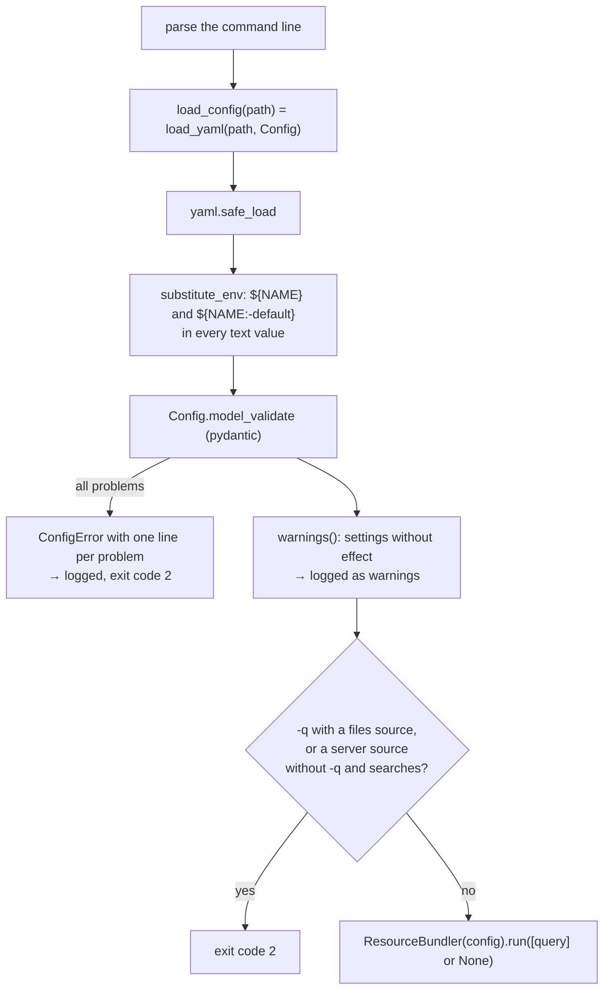
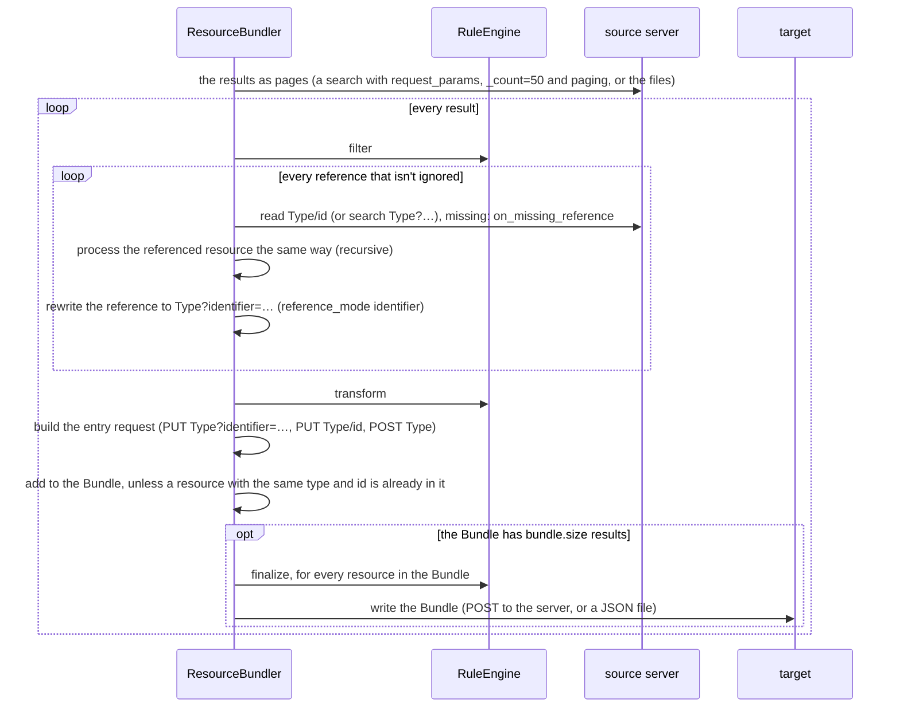

# fhirsync architecture

This document is for developers who change or extend fhirsync. It describes how the parts work together and why they
are built the way they are. For using fhirsync, see the [README](README.md); for the rules, see
[docs/rules.md](docs/rules.md).

- [Overview](#overview)
- [Modules](#modules)
- [Startup and configuration](#startup-and-configuration)
- [The bundler](#the-bundler)
- [Sources](#sources)
- [The rule engine](#the-rule-engine)
- [The library API](#the-library-api)
- [Connections: dic-helper-toolkit](#connections-dic-helper-toolkit)
- [Error handling](#error-handling)
- [Tests](#tests)
- [Design decisions](#design-decisions)
- [Known limitations](#known-limitations)

## Overview

fhirsync reads FHIR resources from a source (a FHIR server or FHIR files), puts every result together with the
resources it references into a Bundle, and writes the Bundles to a target server or to files. Rules from the
configuration filter and change the resources on the way.

Nothing in fhirsync is specific to gICS. The gICS specifics are in the configuration: the rules of
[config-example.yaml](config-example.yaml). Event-driven syncs, e.g. on gICS's MQTT notifications, belong in an
application that runs a search through the library API for each event.

## Modules

| Module | Responsibility | Main entry points |
|---|---|---|
| [fhirsync/\_\_init\_\_.py](fhirsync/__init__.py) | the public library API | see [The library API](#the-library-api) |
| [fhirsync/cli.py](fhirsync/cli.py) | command line, exit codes, logging setup | `run()`, the `fhirsync` command |
| [fhirsync/config.py](fhirsync/config.py) | YAML loading, environment variables, validation, error messages, warnings, per-type settings | `load_yaml()`, `load_config()`, `Config`, `ConfigModel` |
| [fhirsync/rules.py](fhirsync/rules.py) | rule models, startup checks of rules, applying rules to resources | `RuleEngine.apply()`, `RuleEngine.check()` |
| [fhirsync/bundler.py](fhirsync/bundler.py) | results, following references, missing references, Bundles, entry requests, output | `ResourceBundler.run()`, `ResourceBundler.fetch_resources()` |
| [fhirsync/sources.py](fhirsync/sources.py) | the source types: FHIR server and FHIR files | `ServerSource`, `FileSource` |

## Startup and configuration

- **The configuration is a tree of pydantic models** in [fhirsync/config.py](fhirsync/config.py), one class per
  section (`Source`, `Target`, `Bundling`, `Processing`, …). All of them derive from `ConfigModel`, which forbids
  unknown fields (`extra="forbid"`), which is how typos become errors.
- **The loader is generic.** `load_yaml(path, model)` works for any `ConfigModel`, so applications load their own
  configuration files with the same behaviour. `load_config(path)` is `load_yaml(path, Config)`.
- **Error messages** are built from pydantic's errors in `load_yaml()`: `_model_at()` finds the model at the error's
  location, and `_message()` uses `difflib` to suggest the closest known name. All errors are collected and reported
  at once.
- **Environment variables are substituted after the YAML is parsed**, so their values never pass through the YAML
  parser and may contain any characters.
- **Cross-field rules** (both username and password, mode `server` needs `base_url`, …) are `model_validator`s on the
  models. `Source.check_type()` checks the source type: `server` needs `base_url`, `files` needs `directory`, the
  settings of the other type (`SERVER_SETTINGS`, `FILES_SETTINGS`) are errors, and the resource types of `searches`
  and `resource_types` must exist in fhir.resources. **Settings without effect** are not errors: every model can list
  its `ignored_settings()`, and `ConfigModel.warnings()` collects them from the whole tree.
- **Per-type settings** are resolved by methods instead of being merged when loading: `Bundling.request_for(type)`,
  `reference_mode_for(type)`, `ignore_references_to_for(type)`, `on_missing_reference_for(type)`,
  `identifier_system_for(type)`, `on_missing_identifier_system_for(type)` and `Source.request_params_for(type)` look
  at the
  type's own setting, then `common`, then the default. That keeps the configuration exactly as written and the
  inheritance rules in one place.
- **Rules are checked at startup.** The `Processing` model builds the `RuleEngine` and runs `RuleEngine.check()`,
  which evaluates every FHIRPath expression once against an empty `Basic` resource. That finds unknown functions,
  wrong numbers of arguments, undefined variables and unconfigured identifier systems before anything is fetched.
- **TLS settings** fall back from a section to `common`: `Config.tls(section)` returns the effective `ca_file` and
  `rfc5280`.

## The bundler

`ResourceBundler.run(searches)` in [fhirsync/bundler.py](fhirsync/bundler.py) runs what the configuration describes:
every search of a server source (`fetch_resources()` per search), or the files of a files source. Both end in
`_bundle_results(pages)`, which processes the results page by page and returns a `SyncResult` with the counts of
written and rejected Bundles:

- **`process_resource()` is a recursive generator.** It yields the referenced resources first and the resource
  itself last. Every resource, referenced or not, goes through the same steps, so rules apply to referenced
  resources too.
- **References are found generically.** `extract_references()` walks the resource's JSON and takes every object with
  a `reference` text, also the entries of a list of References (`Observation.performer`): `Type/id` is read,
  `Type?params` is searched, anything else is logged as malformed and left alone. The path of each reference is
  remembered, so `update_reference()` can rewrite exactly that place.
- **Missing references.** `fetch_reference()` asks the source; if it has nothing, `_missing_reference()` raises
  `MissingReferenceError` or, with `on_missing_reference: warning` for the referencing type, logs a warning. Nothing
  is yielded then, so the reference isn't rewritten.
- **The identifier for a rewritten reference** is taken from the referenced resource *after* its transform rules, so
  identifiers set by rules are used. `_identifier()` picks it: the one with the type's `identifier_system`, otherwise
  the first one (`get_primary_identifier()`, with `on_missing_identifier_system` for a missing system).
- **The entry request** is built by `create_entry_request()` from `Bundling.request_for(type)`. Identifier-based
  requests raise `ValueError("Resource Type/id has no identifier.")` for a resource without identifier, which ends the
  run.
- **finalize runs per Bundle** (`post_process_bundle()`), after all requests were built, so a request can still use
  the source `id` that finalize removes.
- **Output:** mode `file` writes `<outdir>/<Bundle identifier>.json`; mode `server` posts the Bundle to the target. A
  `404` from the target is logged with the target's OperationOutcome and the run continues; any other HTTP error ends
  the run.

## Sources

[fhirsync/sources.py](fhirsync/sources.py) has one class per source type. The bundler creates the one of
`source.type` and only uses three operations, so it doesn't know which type it has:

| Operation | `ServerSource` | `FileSource` |
|---|---|---|
| `pages()`: the results | the result pages of one search (`FHIRClient.search()`) | one page per file, filtered by `resource_types` |
| `read(type, id)`: a `Type/id` reference | `FHIRClient.get_resource()`; `None` for 404, other HTTP errors are raised | the index by type and id; `None` if not in the files |
| `search(type, params)`: a `Type?…` reference | the result pages, `[]` if no page has an entry (known limitation: the pages are processed as resources) | always `[]`, not supported |

- **`FileSource` reads everything in its constructor:** `DirectoryReader` lists the files, `FHIRFileReader` reads
  them (with `unpack_bundles` and `on_error`), and every resource with an id goes into the index. A second resource
  with the same type and id gets a warning; the first one stays in the index. Reading everything first is what makes
  references between files resolvable, at the price of memory proportional to the input.
- **Searches are server-only.** `run()` and `fetch_resources()` raise `ValueError` for searches with a files source;
  the command line already rejects `-q` with exit code 2.
- **New source types** implement the same three operations and are chosen in `ResourceBundler.__init__()`.

## The rule engine

[fhirsync/rules.py](fhirsync/rules.py) has two layers:

- **Rule models** (`Skip`, `Extract`, `Set`, `SetIdentifier`, `Python`, `Rule`, `RuleSet`) validate the structure
  when the configuration is loaded: exactly one operation per rule, operations allowed in their phase
  (`PHASE_OPERATIONS`), valid element paths (`ELEMENT_PATH`), regular expressions and variable names.
- **`RuleEngine`** applies the rules. `apply(phase, resource, variables)`:
  1. collects the rules of `"*"` and of the resource type for the phase,
  2. converts the resource to a JSON `dict`,
  3. applies the rules in order (`_apply_rule()`); `extract` writes into `variables`, which the bundler keeps per
     resource from filter to transform,
  4. converts the `dict` back into a `fhir.resources` model. A resource that is no longer valid stops the run.

**Expressions** are evaluated with [fhirpathpy](https://github.com/beda-software/fhirpath-py) and its R4 model
(`FHIR_MODEL`), which is needed for choice elements like `value.ofType(Quantity)`. The fhirsync functions
`identifierSystem()` and `sha256()` are passed as fhirpathpy's `userInvocationTable`. **Templates** (`_render()`)
replace every `{expression}` with its first result; `{{` and `}}` are literal braces. **Element paths** (`set.path`,
`delete`) are not FHIRPath: `parse_path()` turns `a.b[0].c` into steps, and `_set()` / `_delete()` walk the `dict`.

**Errors while applying a rule** are wrapped in a `RuleError` that names the rule (`processing.rules.Consent.transform[1]`)
and the resource. Nothing catches them: a failing rule ends the run.

## The library API

[fhirsync/\_\_init\_\_.py](fhirsync/__init__.py) exports what applications use: `load_config()`, `load_yaml()`,
`ConfigModel`, `Config`, `ConfigError`, `ResourceBundler`, `SyncResult`, `RuleError` and `MissingReferenceError`.
Everything else is internal and may change. The command line in [fhirsync/cli.py](fhirsync/cli.py) uses the same API.

- **No side effects on import.** Logging is configured in `cli.run()`, not when the package is imported, and the
  modules don't set log levels. An application decides how fhirsync logs.
- **One bundler, many searches.** A `ResourceBundler` keeps its source, clients and rule engine, and `run()` and
  `fetch_resources()` keep no state between runs, so an application creates one bundler and runs a search per event.
  `run()` does what the command does; `fetch_resources()` runs a single search with extra parameters.
- **Search parameters as a dict.** `fetch_resources(search, params)` merges `source.request_params`, the parameters
  of `search` and `params`, in this order of precedence. Applications pass values such as `system|value` without
  encoding them themselves.
- **Errors are raised, not handled.** The library doesn't decide whether an error ends a process; the command line
  ends with exit code 1, an event-driven application can log the error and continue with the next event.

## Connections: dic-helper-toolkit

The HTTP side is in the separate package [`dic-helper-toolkit`](https://pypi.org/project/dic-helper-toolkit/)
(module `dic_helpers`, source at github.com/haemka/dic-helper-toolkit), from PyPI:

- **`HTTPClient`** handles authentication and TLS. Basic authentication with username and password. OAuth 2.0 with
  Keycloak: the token endpoint is discovered from `<auth_url>/realms/<realm>/.well-known/openid-configuration`; with
  username and password the password flow is used, otherwise client credentials. `ca_file` becomes the session's
  `verify`; `rfc5280: false` mounts an adapter without the strict flag.
- **`FHIRClient`** adds FHIR: `search()` pages through results (standard `next` links, or offset paging with
  `next_param`), `get_resource()` reads `Type/id`, `post_bundle()` posts a Bundle.

`ResourceBundler._client()` passes the configured settings to `FHIRClient`; nothing else in fhirsync talks HTTP.
Changes to paging or authentication belong in that package, with its own tests.

## Error handling

| Situation | Where | Result |
|---|---|---|
| invalid command line | `argparse` in `run()` | exit code 2 |
| invalid configuration, invalid rules | `load_config()` raises `ConfigError` | all problems logged, exit code 2 |
| settings without effect | `Config.warnings()` | warnings, the run continues |
| a rule fails, a resource is invalid after a phase | `RuleEngine.apply()` raises `RuleError` | exit code 1 with traceback |
| identifier-based request without identifier | `get_primary_identifier()` raises `ValueError` | exit code 1 with traceback |
| source or target unreachable, HTTP errors | `requests` exceptions | exit code 1 with traceback |
| invalid FHIR file, line or resource | `FHIRFileReader` raises `FHIRFileError` (`on_error: raise`) | exit code 1 with traceback |
| invalid FHIR file with `on_error: skip` | `FHIRFileReader` | logged, the run continues |
| missing reference | `_missing_reference()` raises `MissingReferenceError` | exit code 1 with traceback |
| missing reference with `on_missing_reference: warning` | `_missing_reference()` | logged, reference unchanged, the run continues |
| target returns 404 for a Bundle | `_send_bundle_to_server()` | logged with the OperationOutcome, the run continues |
| a resource skipped by a rule | `RuleEngine.apply()` | logged, the run continues |

Stopping is the default on purpose: a run that continues after a failing rule could write wrong data to the target.

## Tests

`uv run pytest tests` runs all tests; none of them need a network. The rule for tests: **every test checks
one documented behaviour, and a comment above it names the section of the README, docs/rules.md or
config-example.yaml it verifies.** Tests are plain code: configurations and rules are written out in each test, no
test is generated from the documentation.

| Directory | What | How |
|---|---|---|
| `tests/config/` | configuration loading, errors, warnings, defaults | `write_and_load_config()` |
| `tests/rules/` | the rule engine | `apply_rules()` on resources from `tests/data/` |
| `tests/cookbook/` | the examples of docs/rules.md section 7 | `apply_rules()` |
| `tests/bundling/` | the bundler | `run_bundler()` on a recorded gICS search, or the `responses` mock |
| `tests/sources/` | the source types, searches, missing references | FHIR files written to `tmp_path`, the `responses` mock |
| `tests/connections/` | authentication and TLS of source and target | `responses` mock, client attributes |
| `tests/library/` | the library API | `responses` mock, a subprocess for the import |
| `tests/cli/` | the `fhirsync` command | subprocess, local HTTP server |
| `tests/project/` | project structure and dependencies | file checks |

Shared functions are in [tests/support.py](tests/support.py), shared resources in [tests/conftest.py](tests/conftest.py)
and [tests/data/](tests/data/).

**Real world data.** The recorded gICS search in `tests/data/gics_consent_status_search.json` was recorded from a local
gICS 2026.1.1 instance with the MII Broad Consent template 1.6.d: the consent-status Consents of three valid patients
and one with an invalid pseudonym, with their ResearchStudy and Patients. The bundling tests run on it.

## Design decisions

- **Rules in the configuration instead of built-in processing.** fhirsync 0.7 had the gICS processing in the code.
  It is now the rules of config-example.yaml, and the bundler knows nothing about gICS.
- **FHIRPath for reading, simple element paths for writing.** FHIRPath is the standard for FHIR expressions, but it
  can only read. Writing uses `a.b[0].c` paths, which name exactly one place.
- **Validate everything at startup, stop on every error while running.** Configuration errors are cheap to fix
  before a run; wrong data on the target is not.
- **Conditional requests by identifier.** `PUT Type?identifier=…` makes repeated syncs update the same resource, and
  rewritten references let the target link resources without knowing the source ids. This needs stable identifiers,
  which is why a resource without identifier stops the run.
- **No sync mode in fhirsync.** The bundler is source and target agnostic, an MQTT listener and the gICS
  notification format are not. fhirsync 0.8 removed the sync mode of 0.7; event-driven applications use the library
  API, so fhirsync has no MQTT dependency.
- **A source interface instead of type checks in the bundler.** Server and files differ only in where results and
  referenced resources come from; everything after that (rules, references, requests, Bundles) is the same code.
- **Missing references stop the run by default.** A Bundle without the resource a reference points to may be
  rejected by the target, or link to the wrong resource; `on_missing_reference: warning` is an explicit choice.
- **Stable Consent identifiers from content.** gICS Consents have no identifier. The gICS rules hash domain, policy
  and patient id, so a Consent keeps its identifier across syncs and gICS upgrades (from gateway 2025.1.0 on).

## Known limitations

- **References with a search URL at the source** (`Patient?identifier=…`) are searched, but the result pages are
  processed instead of the found resources. gICS only uses `Type/id`. Test:
  `tests/bundling/test_references.py::test_search_url_reference_at_the_source` (expected failure).
- **Duplicates are only detected per Bundle**, by resource type and id. With `bundle.size: 1`, a ResearchStudy
  referenced by every Consent is written once per Bundle; the conditional request keeps it unique on the target.
- **One search at a time.** Searches, reads and Bundle uploads run sequentially.
- **A files source is read into memory completely** before processing, for the reference index.
- **`Type?…` references can't be resolved from files**; they count as missing.
- **One source per configuration.** Several sources, operations like `$everything` and other output formats are not
  supported yet.
