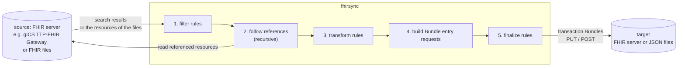

# fhirsync

fhirsync copies FHIR resources from a source FHIR server or from FHIR files to a target FHIR server or to files. It
searches the source server (or reads the files), follows the references of every result and puts each result together
with the resources it references into a FHIR Bundle, so every Bundle can be written to the target on its own. On the
way, configurable **processing rules** filter and change the resources, for example to point references to the
target's patients or to give resources stable identifiers.

fhirsync is a command line tool and a Python library. Its main use today is syncing patient consents from
[**gICS**](https://www.ths-greifswald.de/en/researchers-general-public/gics/) (the consent management of the THS
Greifswald) to a FHIR server; [config-example.yaml](config-example.yaml) is a complete setup for that (see
[Syncing gICS consents](#syncing-gics-consents)). Nothing in fhirsync is specific to gICS, though: what happens to the
resources is entirely defined by the configuration.

The FHIR and HTTP side (FHIR client, authentication with OAuth 2.0 or basic authentication, TLS) and reading FHIR files
come from [dic-helper-toolkit](https://github.com/haemka/dic-helper-toolkit), a separate library of helpers for Data
Integration Centers.

- [How it works](#how-it-works)
- [Requirements](#requirements)
- [Installation](#installation)
- [Usage](#usage)
- [Configuration](#configuration)
- [Processing rules](#processing-rules)
- [Using fhirsync as a library](#using-fhirsync-as-a-library)
- [Important behaviour](#important-behaviour)
- [Syncing gICS consents](#syncing-gics-consents)
- [Upgrading from fhirsync 0.8 and 0.9](#upgrading-from-fhirsync-08-and-09)
- [Development](#development): [Testing](#testing), [Project structure](#project-structure), and
  [ARCHITECTURE.md](ARCHITECTURE.md) for developers
- [License](#license)


## How it works



For every result (a search result, or a resource from the files) fhirsync:

1. **Filters** it: rules can skip resources or read values from them.
2. **Follows its references**: resources referenced as `Type/id` are read from the source and processed the same way,
   recursively. Every Reference counts, wherever it is in the resource, also in lists like `Observation.performer`.
   References to other resources in the Bundle are rewritten to the conditional form
   `Type?identifier=system|value`, so the target links them to its own copies.
3. **Transforms** it: rules set and remove elements and identifiers.
4. **Builds the request** of its Bundle entry, by default a conditional update `PUT Type?identifier=system|value`.
5. **Finalizes** it: rules remove what only the request needed, e.g. the source server's `id`.

A Bundle holds a configurable number of results with their referenced resources. It is posted to the target server,
or written to a file.

The source is one of two types:

- **`server`**: a FHIR server. fhirsync runs the searches configured in `source.searches`, or the search given with
  `-q`, one after another, and syncs their results.
- **`files`**: FHIR files in a directory (JSON, NDJSON or FHIR XML, optionally gzip compressed). All files are read,
  every resource in them is a result (or only those of `source.resource_types`), and references are resolved from the
  files.

The `fhirsync` command does one such run, for initial loads, re-syncs, imports or tests. Applications run the same
from their own code (see [Using fhirsync as a library](#using-fhirsync-as-a-library)).


## Requirements

- **Python 3.13 or newer.**
- **A source FHIR server** reachable from the host, or **FHIR files**. For gICS, see
  [Syncing gICS consents](#syncing-gics-consents).


## Installation

Requires **Python 3.13 or newer**: the strict RFC 5280 certificate checks (`rfc5280: true`, the default) are Python's
default from 3.13 on.

```shell
pip install fhir-sync
```

The package is published on [PyPI](https://pypi.org/project/fhir-sync/) and installs the `fhirsync` command. To read
FHIR XML files, install the `xml` extra: `pip install fhir-sync[xml]`. Applications that use fhirsync as a library add
`fhir-sync` as a dependency (see [Using fhirsync as a library](#using-fhirsync-as-a-library)). All dependencies,
including [dic-helper-toolkit](https://pypi.org/project/dic-helper-toolkit/), come from PyPI.

For development, see [Development](#development).


## Usage

```sh
fhirsync [-c CONFIG] [-q QUERY]
```

| Option | Meaning |
|---|---|
| `-c`, `--config` | the configuration file, default: `config.yaml` in the current directory |
| `-q`, `--query` | a FHIR search instead of `source.searches`, e.g. `Consent?domain:identifier=MII`; source type `server` only |

The sync mode of fhirsync 0.7 and older (`-s`, MQTT notifications) was removed in 0.8; `-s` exits with code 2.

### Searches (source type server)

Without `-q`, fhirsync runs the searches of `source.searches`, one after another:

```yaml
source:
  base_url: https://gicsserver/ttp-fhir/fhir/gics/
  # what applies to every search of a type
  request_params:
    Consent:
      category: http://fhir.de/ConsentManagement/CodeSystem/ResultType|consent-status
  # what to fetch: only what is specific to each search
  searches:
    - Consent?domain:identifier=MII
    - ResearchStudy
```

`-q` replaces them for one run, e.g. for a re-sync or a single patient:

```sh
# all consent-status Consents of the MII domain (the category comes from source.request_params)
fhirsync -c config.yaml -q 'Consent?domain:identifier=MII'

# all resources of a type, with the parameters configured for it
fhirsync -c config.yaml -q Consent

# a single patient's consent status
fhirsync -c config.yaml -q 'Consent?domain:identifier=MII&patient.identifier=https://ths-greifswald.de/fhir/gics/identifiers/Pseudonym|1000000001'
```

- **A search** is `<ResourceType>` or `<ResourceType>?<parameters>`, relative to `source.base_url`. Quote `-q` in the
  shell, because of `&` and `|`. `-q` takes one search.
- **`searches` and `request_params` have different roles.** A search says *what* is fetched: put only what is
  specific to it into the search, e.g. a domain or a patient. `source.request_params` says *how* every search of a
  resource type is made: put what applies to all of them there, e.g. `_count`, `_profile` or a `category`. They are
  added to every search of that type: the `searches`, `-q`, searches of applications that use fhirsync as a library, and
  searches for `Type?…` references. A parameter given in both places takes the search's value, except for `Type?…`
  references, where the configured value wins.
- **Paging:** fhirsync pages through all results, following `next` links, or using offsets if `source.next_param` is
  set.
- **Without `-q` and without `source.searches`** there is nothing to run, which is an invalid command line.

### Files (source type files)

```yaml
source:
  type: files
  directory: /data/export
  recursive: true
  resource_types: [Consent]
```

```sh
fhirsync -c config.yaml
```

- **All files are read first**, when fhirsync starts: the files in `directory` (and its subdirectories with
  `recursive`) whose names match `patterns`, by default all JSON, NDJSON and XML files, also gzip compressed. Hidden
  files are skipped. A missing directory is an error.
- **Formats:** `.json` (a resource), `.ndjson` (a resource per line), `.xml` (a resource in FHIR XML, needs the extra
  `xml`), each optionally `.gz`. Bundles in files give the resources of their entries (`unpack_bundles`).
- **Results:** every resource of the files, or only those of `resource_types`; the others are then only used when
  they are referenced. Each file is one page: with `bundling.bundle.size: 0`, one Bundle per file.
- **References** are resolved from the files, by type and id. A resource that occurs twice is used once, with a
  warning. References written as `Type?<parameters>` can't be resolved from files (see
  [Important behaviour](#important-behaviour)).
- **Invalid files** stop the run (`on_error: raise`), or are skipped with a warning (`on_error: skip`).
- **`-q`** can't be used with files.

### Exit codes and logging

- **0** means success.
- **2** means an invalid command line or configuration, e.g. no search for a server source, or `-q` with a files
  source. The configuration error is logged with all problems found.
- **1** means an error while running, e.g. an unreachable server, an invalid file, a failing rule, a missing
  reference, or a resource without the identifier its request needs (see [Important behaviour](#important-behaviour)).
  The error is printed with a traceback.

Logging goes to standard error, with timestamps, at level `INFO`. Each processed resource, fetched reference and
written Bundle is logged. At the end, the number of written and rejected Bundles is logged.


## Configuration

The configuration is a YAML file. **[config-example.yaml](config-example.yaml) documents every setting** with its
default. Copy it to `config.yaml` and adapt it. When fhirsync starts, it validates the whole file and reports all
problems at once:

```
Invalid configuration in config.yaml:
  source.auth: auth_url, realm, client_id also need client_secret
  bundling.bundle.sise: unknown configuration variable, did you mean 'size'?
```

- **Errors** stop fhirsync before anything is fetched or sent: unknown variables (with a suggestion for typos),
  incomplete settings (half an authentication, a target mode without its URL or directory), invalid values, and
  invalid rules.
- **Warnings** are logged for settings that have no effect, e.g. `target.outdir: ignored, not used in mode server`.
  fhirsync continues.

### Secrets and environment variables

Any text value can use `${NAME}` or `${NAME:-default}`:

```yaml
source:
  auth:
    auth_url: https://authserver/auth
    realm: REALM
    client_id: fhirsync
    client_secret: ${GICS_CLIENT_SECRET}
target:
  mode: server
  base_url: ${FHIR_TARGET_URL:-https://fhirserver/fhir}
```

- **An unset variable without a default** is an error that names the variable and the setting.
- **Substitution happens after the YAML is read**, so values may contain any characters.
- **Inside inline mappings** (`{ … }`), quote values that contain `${…}`.

### Settings reference

Paths are written as `section.key`. "common" in a per-type section applies to all resource types, and a type's own
setting overrides it (see below).

**`common`**: defaults for the TLS connections to source and target

| Setting | Default | Meaning |
|---|---|---|
| `common.ca_file` | none (system CAs) | CA certificate file (PEM). If set, only this file is trusted. |
| `common.rfc5280` | `true` | strict RFC 5280 certificate checks; `false` for non-conforming internal CAs |

**`source`**: where the resources come from (required)

| Setting | Default | Meaning |
|---|---|---|
| `source.type` | `server` | `server`: a FHIR server; `files`: FHIR files. The settings of the other type are errors. |

With `type: server`:

| Setting | Default | Meaning |
|---|---|---|
| `source.base_url` | required | base URL of the FHIR endpoint |
| `source.auth.username`, `.password` | none | basic authentication; both or neither |
| `source.auth.auth_url`, `.realm`, `.client_id`, `.client_secret` | none | OAuth 2.0 via Keycloak; all four or none. With username/password: password flow, otherwise client credentials flow |
| `source.ca_file`, `source.rfc5280` | `common.*` | TLS settings for this server |
| `source.next_param` | none | query parameter for offset paging, for servers without `next` links (gICS), e.g. `_offset` |
| `source.request_params.<common\|Type>.<param>` | none | defaults for every search of the type (`searches`, `-q`, applications, `Type?…` references); a search's own parameters take precedence, except in `Type?…` references; a list value repeats the parameter |
| `source.searches` | none | the searches of a run, each `<Type>` or `<Type>?<parameters>`; `-q` replaces them. Unknown resource types are errors. |

With `type: files`:

| Setting | Default | Meaning |
|---|---|---|
| `source.directory` | required | the directory with the FHIR files |
| `source.patterns` | `*.json`, `*.ndjson`, `*.xml`, `*.json.gz`, `*.ndjson.gz`, `*.xml.gz` | file name patterns (`*`, `?`, `[seq]`, case-sensitive) of the files to read |
| `source.recursive` | `false` | also read the files of all subdirectories |
| `source.include_hidden` | `false` | also read hidden files (`.name`) and hidden subdirectories |
| `source.follow_symlinks` | `false` | also read subdirectories that are symbolic links |
| `source.unpack_bundles` | `true` | a Bundle in a file gives the resources of its entries; `false`: the Bundle itself |
| `source.on_error` | `raise` | an invalid file, line or resource: `raise` stops the run, `skip` logs a warning and continues |
| `source.resource_types` | all | the resource types that are results; the others are only used as reference targets. Unknown resource types are errors. |

**`target`**: where the Bundles go (required)

| Setting | Default | Meaning |
|---|---|---|
| `target.mode` | required | `server` or `file` |
| `target.base_url` | required with `server` | base URL of the target FHIR endpoint |
| `target.outdir` | required with `file` | directory for the Bundle files `<identifier>.json` |
| `target.auth.*` | none | as `source.auth`, only with `server` |
| `target.ca_file`, `target.rfc5280` | `common.*` | TLS settings, only with `server` |

**`bundling`**: Bundles and requests

| Setting | Default | Meaning |
|---|---|---|
| `bundling.bundle.type` | `transaction` | `transaction`, `batch` or `collection` |
| `bundling.bundle.size` | `1` | results per Bundle, plus their referenced resources; `0` for one Bundle per search page or file |
| `bundling.bundle.identifier_system` | `http://www.uniklinikum-jena.de/fhir/sid/consentBundle` | system of `Bundle.identifier`; its value is a random UUID |
| `bundling.resources.<common\|Type>.request.method` | `put` | `put` (create or update) or `post` (create) |
| `bundling.resources.<common\|Type>.request.url` | `identifier` | for `put`: `identifier` (`PUT Type?identifier=…`, needs an identifier) or `id` (`PUT Type/<source id>`) |
| `bundling.resources.<common\|Type>.request.condition` | none | for `post`: `ifNoneExist`, create only if no resource with the identifier that counts exists |
| `bundling.resources.<common\|Type>.reference_mode` | `identifier` | `identifier`: rewrite references from this type to resources in the Bundle to `Type?identifier=…`; `as_is`: leave them |
| `bundling.resources.<common\|Type>.ignore_references_to` | `[]` | resource types whose references from this type are not followed (and not rewritten) |
| `bundling.resources.<common\|Type>.on_missing_reference` | `error` | a reference from this type the source doesn't have: `error` stops the run, `warning` logs it and leaves the reference unchanged |
| `bundling.resources.<common\|Type>.identifier_system` | none | the system of the identifier that counts for this type's requests, `ifNoneExist` conditions and references to it; none: the first identifier |
| `bundling.resources.<common\|Type>.on_missing_identifier_system` | `error` | a resource without an identifier of `identifier_system`: `error` stops the run, `first` logs a warning and uses its first identifier. Only with `identifier_system`. |

**`processing`**: filtering and changing resources, see [docs/rules.md](docs/rules.md)

| Setting | Default | Meaning |
|---|---|---|
| `processing.identifier_systems.<Type>` | none | identifier system per resource type, for `identifierSystem('<Type>')` in rules |
| `processing.rules.<Type\|"*">.<filter\|transform\|finalize>` | none | the rules |

### `common` and per-type settings

In `source.request_params` and `bundling.resources`, the key `common` applies to all resource types, and a resource
type's own key overrides it:

- **Single values** (`method`, `url`, `condition`, `reference_mode`, `on_missing_reference`, `identifier_system`,
  `on_missing_identifier_system`) are overridden one by one. With
  `common.request: {method: put, url: id}` and `Patient.request: {url: identifier}`, Patient gets `put` with
  `identifier`.
- **Lists** (`ignore_references_to`) are replaced as a whole. `Encounter: {ignore_references_to: []}` follows all
  references, even if `common` ignores some.
- **Search parameters** are merged parameter by parameter. With `common: {_count: '10', _lastUpdated: ge2025}` and
  `Consent: {_lastUpdated: ge2026}`, Consent searches use `_count=10&_lastUpdated=ge2026`.


## Processing rules

Rules filter and change the resources. They are written per resource type and phase, and use
[FHIRPath](https://hl7.org/fhirpath/) to read values:

```yaml
processing:
  identifier_systems:
    Patient: http://hospital.example/sid/patient
  rules:
    Consent:
      filter:
        - skip: {when: "status != 'active'"}
        - extract: {name: pat_id, from: patient.display, pattern: '^\s*\S+\s+(\d{10})\s*$'}
      transform:
        - set: {path: patient.reference, value: "Patient?identifier={identifierSystem('Patient')}|{%pat_id}"}
        - delete: patient.display
    "*":
      finalize:
        - delete: [id, meta.lastUpdated]
```

**[docs/rules.md](docs/rules.md)** describes the phases, every operation, the expression language and its pitfalls,
with a cookbook of tested real world examples. Examples include skipping resources, stable identifiers from natural
keys, pseudonymisation, tagging, and custom Python functions.


## Using fhirsync as a library

Applications add `fhir-sync` as a dependency and import the package `fhirsync`:

```python
from fhirsync import ConfigError, ResourceBundler, load_config

config = load_config("config.yaml")              # raises ConfigError with all problems
bundler = ResourceBundler(config)                # one bundler can run many searches
result = bundler.fetch_resources("Consent", params={
    "patient.identifier": "https://ths-greifswald.de/fhir/gics/identifiers/Pseudonym|1000000001",
})
print(result.bundles, result.entries, result.rejected)
```

| API | Meaning |
|---|---|
| `load_config(path)` | loads and validates a fhirsync configuration file, as the command does; raises `ConfigError` |
| `ResourceBundler(config)` | the bundler for a configuration; for a files source, all files are read here |
| `ResourceBundler.run(searches=None)` | runs like the command: the searches of a server source (`searches` instead of `source.searches`, like `-q`), or the files of a files source; returns the added-up `SyncResult` |
| `ResourceBundler.fetch_resources(search, params=None)` | runs one search of a server source and returns a `SyncResult` |
| `SyncResult` | `bundles` and `entries` written to files or accepted by the target, `rejected`: Bundles the target answered with 404 |
| `load_yaml(path, model)`, `ConfigModel` | load an application's own YAML configuration like fhirsync's (see below) |
| `Config`, `ConfigError`, `RuleError`, `MissingReferenceError` | the configuration model and the errors |

- **Search parameters** in `params` are not URL encoded; a list value repeats the parameter. They take precedence
  over the parameters in `search`, which take precedence over `source.request_params`. As for `searches`: pass what
  is specific to this search, and leave what applies to every search of the type to `source.request_params`.
- **Errors** are raised, as with the command: `RuleError` for a failing rule, `MissingReferenceError` for a missing
  reference with `on_missing_reference: error`, `ValueError` for a resource without the identifier its request needs
  and for searches with a files source, `requests` exceptions for connection and HTTP errors, and dic-helper-toolkit's
  `FHIRFileError` for an invalid file with `on_error: raise`. A 404 from the target is only counted in `rejected`.
- **Logging** uses the loggers `fhirsync.*` and is not configured by fhirsync; that is up to the application.
- **Own configuration files:** a class derived from `ConfigModel` and loaded with `load_yaml(path, Model)` gets the
  same behaviour as fhirsync's file: `${…}` environment variables, all errors at once with suggestions for typos, and
  warnings for the settings its `ignored_settings()` reports.


## Important behaviour

> **Without rules, no resource is changed.** Resources are still fetched, bundled and sent, but exactly as the source
> delivered them, including the source server's `id` and `meta.lastUpdated`. Many servers reject conditional updates
> whose body contains a different `id`. Almost every configuration therefore needs at least:
>
> ```yaml
> processing:
>   rules:
>     "*":
>       finalize:
>         - delete: [id, meta.lastUpdated]
> ```

> **A resource without an identifier stops the whole run** when its request is identifier based
> (`request.url: identifier`, the default, or `condition: ifNoneExist`). The error is
> `Resource <Type>/<id> has no identifier.`. This is intended: no resource is written to the target without a stable
> identity. Resources whose source has no identifier need a `set_identifier` rule; gICS's `consent-status` Consents
> are an example. Otherwise use `request.url: id` for that type.

> **The first identifier counts,** unless `identifier_system` is configured for the resource type. Request URLs,
> `ifNoneExist` conditions and rewritten references all use a resource's first identifier, or the one with the
> configured system. A resource without an identifier of that system stops the run, unless
> `on_missing_identifier_system: first` is set. This also applies to resource types with a single identifier, such as
> `QuestionnaireResponse`.

> **A failing rule stops the run**, e.g. a template expression without a result. Invalid rules are already reported
> at startup.

> **A missing reference stops the run** by default (`on_missing_reference: error`): a referenced `Type/id` the
> source server answers with 404, or that the files don't contain, and a `Type?<parameters>` reference whose search
> finds nothing (with files: every such reference). The error names the reference, the resource and the setting.
> With `on_missing_reference: warning` for the referencing type, the reference is logged and left unchanged.

- **Ignored references are not rewritten.** A reference to a type in `ignore_references_to` keeps pointing to the
  source server's id. Set it with a rule if the target needs it, as the gICS rules do for `Consent.patient`.
- **Skipping leaves references unchanged.** If a `filter` rule skips a referenced resource, the reference to it is
  not rewritten.
- **Duplicates:** a resource that several results reference is only added once per Bundle.
- **Empty Bundles,** e.g. when all resources were skipped, are not written.


## Syncing gICS consents

[config-example.yaml](config-example.yaml) is a complete setup for syncing the `consent-status` Consents of a
[gICS](https://www.ths-greifswald.de/en/researchers-general-public/gics/) domain `MII` from gICS's TTP-FHIR Gateway
to a FHIR server. Its rules reproduce the processing that was built into fhirsync 0.7 and older (see
[docs/rules.md, section 7.2](docs/rules.md#72-a-complete-rule-set-gics-consents)). A sync of all consents of the
domain:

```sh
fhirsync -c config.yaml -q 'Consent?domain:identifier=MII'
```

What the setup expects:

- **Signer id type `Pseudonym`, with 10 digit pseudonyms.** The patient id is read from `Consent.patient.display`
  (`Pseudonym 1000000001`), the only place gICS puts it. Consents with other ids are skipped with a warning.
- **The target already contains the patients**, with the identifier system `processing.identifier_systems.Patient`.
  gICS's own Patient resources are not synced (`ignore_references_to: [Patient]`).


## Upgrading from fhirsync 0.8 and 0.9

fhirsync 0.10 adds FHIR files as a source (`source.type: files`) and searches in the configuration
(`source.searches`). Existing configurations stay valid: `source.type` defaults to `server`.

- **`-q` is optional:** without it, the searches of `source.searches` are run. A server source without both is an
  invalid command line (exit code 2) instead of the former "required argument" error.
- **Missing references stop the run by default** (`on_missing_reference: error`). A `Type/id` reference the server
  answers with 404 already stopped the run, now with a `MissingReferenceError` instead of an `HTTPError`. **New:** a
  `Type?<parameters>` reference whose search finds nothing stops the run too; before, it was silently left unchanged.
  Set `bundling.resources.<common|Type>.on_missing_reference: warning` for the previous behaviour.
- **References in lists are followed:** References held directly in a list, e.g. `Observation.performer` or
  `Consent.organization`, were not found before, so they were neither followed nor rewritten. Now they are, like
  every other reference; a missing one stops the run by default (see above). The gICS rules are not affected: gICS
  Consents only carry the organization's name.
- **Choosing the identifier:** `bundling.resources.<common|Type>.identifier_system` picks the identifier with that
  system for requests and references, instead of the first one. Without it nothing changes.
- **Library:** `ResourceBundler.run()` runs like the command; `fetch_resources()` is still there for single searches
  of a server source. `ResourceBundler.source_client` is `None` for a files source.


## Development

```sh
git clone https://github.com/haemka/fhirsync.git
cd fhirsync
uv sync
uv run fhirsync --help
```

[uv](https://docs.astral.sh/uv/) installs fhirsync with all dependencies and the development tools (`pytest`,
`responses`) from the `dev` dependency group; `uv sync --extra xml` adds the XML support. Every push runs the tests
in GitHub Actions; a push to `master` publishes the version in `pyproject.toml` to PyPI.


### Testing

```sh
uv run pytest tests
```

Each test checks one documented behaviour. A comment above it names the section of this README,
[docs/rules.md](docs/rules.md) or [config-example.yaml](config-example.yaml) it verifies.

- **`tests/config/`:** loading and validating configurations, defaults, errors, warnings, environment variables
- **`tests/rules/`:** the rule engine: operations, templates, FHIRPath, variables, startup checks
- **`tests/cookbook/`:** the cookbook examples of [docs/rules.md](docs/rules.md)
- **`tests/bundling/`:** the bundler with rules, references, identifiers and requests, on recorded gICS responses
- **`tests/sources/`:** the source types: files, the searches of a server source, missing references
- **`tests/library/`:** the library API
- **`tests/cli/`:** the `fhirsync` command: options, exit codes, logging
- **`tests/connections/`:** authentication and TLS of the source and target connections
- **`tests/project/`:** project structure, Python version and dependencies

The recorded gICS responses in `tests/data/` were recorded from a local gICS 2026.1.1 instance with the MII Broad
Consent template 1.6.d.


### Project structure

```
fhirsync/
  __init__.py      the library API
  cli.py           the fhirsync command
  config.py        configuration: YAML loading, validation, environment variables
  bundler.py       results, references, Bundles, requests, output
  sources.py       the source types: FHIR server and FHIR files
  rules.py         the processing rule engine
docs/
  rules.md         processing rules and expression language
tests/
  config/ rules/ cookbook/ bundling/        tests, see Testing
  sources/ library/ cli/ connections/ project/
  support.py, conftest.py                   shared test functions and fixtures
  data/                   resources, rules and recorded responses used by the tests
ci/
  verify_published_package.py   CI check of the package published on PyPI
config-example.yaml       documented example configuration
ARCHITECTURE.md           how fhirsync is built, for developers
LICENSE                   the MIT License
.github/workflows/ci.yml  CI (GitHub Actions): build, test, publish to PyPI, tag the release
```


## License

fhirsync is licensed under the [MIT License](LICENSE).
