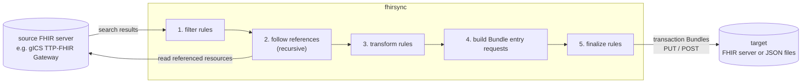

# fhirsync

fhirsync copies FHIR resources from a source FHIR server to a target FHIR server or to files. It searches the source,
follows the references of every result and puts each result together with the resources it references into a FHIR
Bundle, so every Bundle can be written to the target on its own. On the way, configurable **processing rules** filter
and change the resources, for example to point references to the target's patients or to give resources stable
identifiers.

fhirsync is a command line tool and a Python library. Its main use today is syncing patient consents from **gICS**
(the consent management of the THS Greifswald) to a FHIR server: on demand with the `fhirsync` command, and
event-driven with the separate project **gics-consent-sync**, which listens to gICS's MQTT notifications and runs
fhirsync as a library. Nothing in fhirsync is specific to gICS, though: what happens to the resources is entirely
defined by the configuration.

- [How it works](#how-it-works)
- [Requirements](#requirements)
- [Installation](#installation)
- [Usage](#usage)
- [Configuration](#configuration)
- [Processing rules](#processing-rules)
- [Using fhirsync as a library](#using-fhirsync-as-a-library)
- [Important behaviour](#important-behaviour)
- [Syncing gICS consents](#syncing-gics-consents)
- [Upgrading from fhirsync 0.7 and older](#upgrading-from-fhirsync-07-and-older)
- [Testing](#testing)
- [Project structure](#project-structure), and [ARCHITECTURE.md](ARCHITECTURE.md) for developers


## How it works



For every search result fhirsync:

1. **Filters** it: rules can skip resources or read values from them.
2. **Follows its references**: resources referenced as `Type/id` are fetched and processed the same way, recursively.
   References to other resources in the Bundle are rewritten to the conditional form
   `Type?identifier=system|value`, so the target links them to its own copies.
3. **Transforms** it: rules set and remove elements and identifiers.
4. **Builds the request** of its Bundle entry, by default a conditional update `PUT Type?identifier=system|value`.
5. **Finalizes** it: rules remove what only the request needed, e.g. the source server's `id`.

A Bundle holds a configurable number of search results with their referenced resources. It is posted to the target
server, or written to a file.

The `fhirsync` command runs one search and syncs its results, for initial loads, re-syncs or tests. Applications run
the same searches from their own code (see [Using fhirsync as a library](#using-fhirsync-as-a-library)).


## Requirements

- **Python 3.12 or newer** and [uv](https://docs.astral.sh/uv/).
- **Access to the GitLab package index** that hosts `dic-helper-toolkit` (see [Installation](#installation)).
- **A source FHIR server** reachable from the host. For gICS, see [Syncing gICS consents](#syncing-gics-consents).


## Installation

```sh
git clone <repository url> fhirsync
cd fhirsync
uv sync
```

`dic-helper-toolkit` comes from a GitLab package index that requires authentication (`[[tool.uv.index]]` named
`py-dic-helper-toolkit` in `pyproject.toml`). Give uv the credentials, for example with a GitLab access token with
the `read_api` scope:

```sh
export UV_INDEX_PY_DIC_HELPER_TOOLKIT_USERNAME=<username>
export UV_INDEX_PY_DIC_HELPER_TOOLKIT_PASSWORD=<access token>
uv sync
```

`uv sync` also installs the development tools (`pytest`, `responses`) from the `dev` dependency group. For a
production installation without them, use `uv sync --no-dev`.


## Usage

```sh
uv run fhirsync [-c CONFIG] -q QUERY
```

| Option | Meaning |
|---|---|
| `-c`, `--config` | the configuration file, default: `config.yaml` in the current directory |
| `-q`, `--query` | a FHIR search, e.g. `Consent?domain:identifier=MII` (required) |

### Queries

```sh
# all consent-status Consents of the MII domain (the category comes from source.request_params)
uv run fhirsync -c config.yaml -q 'Consent?domain:identifier=MII'

# all resources of a type, with the parameters configured for it
uv run fhirsync -c config.yaml -q Consent

# a single patient's consent status
uv run fhirsync -c config.yaml -q 'Consent?domain:identifier=MII&patient.identifier=https://ths-greifswald.de/fhir/gics/identifiers/Pseudonym|1000000001'
```

- **The query** is `<ResourceType>` or `<ResourceType>?<parameters>`, relative to `source.base_url`. Quote it in the
  shell, because of `&` and `|`.
- **Parameters** configured in `source.request_params` for the resource type are added; the query's own parameters
  take precedence.
- **Paging:** fhirsync pages through all results, following `next` links, or using offsets if `source.next_param` is
  set.

### Exit codes and logging

- **0** means success.
- **2** means an invalid command line or configuration. The configuration error is logged with all problems found.
- **1** means an error while running, e.g. an unreachable server, a failing rule, or a resource without the
  identifier its request needs (see [Important behaviour](#important-behaviour)). The error is printed with a
  traceback.

Logging goes to standard error, with timestamps, at level `INFO`. Each processed resource, fetched reference and
written Bundle is logged. At the end, the number of written and rejected Bundles is logged.


## Configuration

The configuration is a YAML file. **[config-example.yaml](config-example.yaml) documents every setting** with its
default. Copy it to `config.yaml` and adapt it. When fhirsync starts, it validates the whole file and reports all
problems at once:

```
Invalid configuration in config.yaml:
  source.auth: auth_url, realm, client_id also need client_secret
  bundling.bundle.sise: unknown configuration variable, did you mean 'size'?
```

- **Errors** stop fhirsync before anything is fetched or sent: unknown variables (with a suggestion for typos),
  incomplete settings (half an authentication, a target mode without its URL or directory), invalid values, and
  invalid rules.
- **Warnings** are logged for settings that have no effect, e.g. `target.outdir: ignored, not used in mode server`.
  fhirsync continues.

### Secrets and environment variables

Any text value can use `${NAME}` or `${NAME:-default}`:

```yaml
source:
  auth:
    auth_url: https://authserver/auth
    realm: REALM
    client_id: fhirsync
    client_secret: ${GICS_CLIENT_SECRET}
target:
  mode: server
  base_url: ${FHIR_TARGET_URL:-https://fhirserver/fhir}
```

- **An unset variable without a default** is an error that names the variable and the setting.
- **Substitution happens after the YAML is read**, so values may contain any characters.
- **Inside inline mappings** (`{ … }`), quote values that contain `${…}`.

### Settings reference

Paths are written as `section.key`. "common" in a per-type section applies to all resource types, and a type's own
setting overrides it (see below).

**`common`**: defaults for the TLS connections to source and target

| Setting | Default | Meaning |
|---|---|---|
| `common.ca_file` | none (system CAs) | CA certificate file (PEM). If set, only this file is trusted. |
| `common.rfc5280` | `true` | strict RFC 5280 certificate checks; `false` for non-conforming internal CAs |

**`source`**: the FHIR server to read from (required)

| Setting | Default | Meaning |
|---|---|---|
| `source.base_url` | required | base URL of the FHIR endpoint |
| `source.auth.username`, `.password` | none | basic authentication; both or neither |
| `source.auth.auth_url`, `.realm`, `.client_id`, `.client_secret` | none | OAuth 2.0 via Keycloak; all four or none. With username/password: password flow, otherwise client credentials flow |
| `source.ca_file`, `source.rfc5280` | `common.*` | TLS settings for this server |
| `source.next_param` | none | query parameter for offset paging, for servers without `next` links (gICS), e.g. `_offset` |
| `source.request_params.<common\|Type>.<param>` | none | search parameters added to searches; a list value repeats the parameter |

**`target`**: where the Bundles go (required)

| Setting | Default | Meaning |
|---|---|---|
| `target.mode` | required | `server` or `file` |
| `target.base_url` | required with `server` | base URL of the target FHIR endpoint |
| `target.outdir` | required with `file` | directory for the Bundle files `<identifier>.json` |
| `target.auth.*` | none | as `source.auth`, only with `server` |
| `target.ca_file`, `target.rfc5280` | `common.*` | TLS settings, only with `server` |

**`bundling`**: Bundles and requests

| Setting | Default | Meaning |
|---|---|---|
| `bundling.bundle.type` | `transaction` | `transaction`, `batch` or `collection` |
| `bundling.bundle.size` | `1` | search results per Bundle, plus their referenced resources; `0` for one Bundle per search page |
| `bundling.bundle.identifier_system` | `http://www.uniklinikum-jena.de/fhir/sid/consentBundle` | system of `Bundle.identifier`; its value is a random UUID |
| `bundling.resources.<common\|Type>.request.method` | `put` | `put` (create or update) or `post` (create) |
| `bundling.resources.<common\|Type>.request.url` | `identifier` | for `put`: `identifier` (`PUT Type?identifier=…`, needs an identifier) or `id` (`PUT Type/<source id>`) |
| `bundling.resources.<common\|Type>.request.condition` | none | for `post`: `ifNoneExist`, create only if no resource with the first identifier exists |
| `bundling.resources.<common\|Type>.reference_mode` | `identifier` | `identifier`: rewrite references from this type to resources in the Bundle to `Type?identifier=…`; `as_is`: leave them |
| `bundling.resources.<common\|Type>.ignore_references_to` | `[]` | resource types whose references from this type are not followed (and not rewritten) |

**`processing`**: filtering and changing resources, see [docs/rules.md](docs/rules.md)

| Setting | Default | Meaning |
|---|---|---|
| `processing.identifier_systems.<Type>` | none | identifier system per resource type, for `identifierSystem('<Type>')` in rules |
| `processing.rules.<Type\|"*">.<filter\|transform\|finalize>` | none | the rules |

### `common` and per-type settings

In `source.request_params` and `bundling.resources`, the key `common` applies to all resource types, and a resource
type's own key overrides it:

- **Single values** (`method`, `url`, `condition`, `reference_mode`) are overridden one by one. With
  `common.request: {method: put, url: id}` and `Patient.request: {url: identifier}`, Patient gets `put` with
  `identifier`.
- **Lists** (`ignore_references_to`) are replaced as a whole. `Encounter: {ignore_references_to: []}` follows all
  references, even if `common` ignores some.
- **Search parameters** are merged parameter by parameter. With `common: {_count: '10', _lastUpdated: ge2025}` and
  `Consent: {_lastUpdated: ge2026}`, Consent searches use `_count=10&_lastUpdated=ge2026`.


## Processing rules

Rules filter and change the resources. They are written per resource type and phase, and use
[FHIRPath](https://hl7.org/fhirpath/) to read values:

```yaml
processing:
  identifier_systems:
    Patient: http://hospital.example/sid/patient
  rules:
    Consent:
      filter:
        - skip: {when: "status != 'active'"}
        - extract: {name: pat_id, from: patient.display, pattern: '^\s*\S+\s+(\d{10})\s*$'}
      transform:
        - set: {path: patient.reference, value: "Patient?identifier={identifierSystem('Patient')}|{%pat_id}"}
        - delete: patient.display
    "*":
      finalize:
        - delete: [id, meta.lastUpdated]
```

**[docs/rules.md](docs/rules.md)** describes the phases, every operation, the expression language and its pitfalls,
with a cookbook of tested real world examples. Examples include skipping resources, stable identifiers from natural
keys, pseudonymisation, tagging, and custom Python functions.


## Using fhirsync as a library

Applications add `fhir-sync` as a dependency and import the package `fhirsync`:

```python
from fhirsync import ConfigError, ResourceBundler, load_config

config = load_config("config.yaml")              # raises ConfigError with all problems
bundler = ResourceBundler(config)                # one bundler can run many searches
result = bundler.fetch_resources("Consent", params={
    "patient.identifier": "https://ths-greifswald.de/fhir/gics/identifiers/Pseudonym|1000000001",
})
print(result.bundles, result.entries, result.rejected)
```

| API | Meaning |
|---|---|
| `load_config(path)` | loads and validates a fhirsync configuration file, as the command does; raises `ConfigError` |
| `ResourceBundler(config)` | the bundler for a configuration |
| `ResourceBundler.fetch_resources(search, params=None)` | runs one search like `-q` and returns a `SyncResult` |
| `SyncResult` | `bundles` and `entries` written to files or accepted by the target, `rejected`: Bundles the target answered with 404 |
| `load_yaml(path, model)`, `ConfigModel` | load an application's own YAML configuration like fhirsync's (see below) |
| `Config`, `ConfigError`, `RuleError` | the configuration model and the errors |

- **Search parameters** in `params` are not URL encoded; a list value repeats the parameter. They take precedence
  over the parameters in `search`, which take precedence over `source.request_params`.
- **Errors** are raised, as with the command: `RuleError` for a failing rule, `ValueError` for a resource without the
  identifier its request needs, `requests` exceptions for connection and HTTP errors. A 404 from the target is only
  counted in `rejected`.
- **Logging** uses the loggers `fhirsync.*` and is not configured by fhirsync; that is up to the application.
- **Own configuration files:** a class derived from `ConfigModel` and loaded with `load_yaml(path, Model)` gets the
  same behaviour as fhirsync's file: `${…}` environment variables, all errors at once with suggestions for typos, and
  warnings for the settings its `ignored_settings()` reports.


## Important behaviour

> **Without rules, no resource is changed.** Resources are still fetched, bundled and sent, but exactly as the source
> delivered them, including the source server's `id` and `meta.lastUpdated`. Many servers reject conditional updates
> whose body contains a different `id`. Almost every configuration therefore needs at least:
>
> ```yaml
> processing:
>   rules:
>     "*":
>       finalize:
>         - delete: [id, meta.lastUpdated]
> ```

> **A resource without an identifier stops the whole run** when its request is identifier based
> (`request.url: identifier`, the default, or `condition: ifNoneExist`). The error is
> `Resource <Type>/<id> has no identifier.`. This is intended: no resource is written to the target without a stable
> identity. Resources whose source has no identifier need a `set_identifier` rule; gICS's `consent-status` Consents
> are an example. Otherwise use `request.url: id` for that type.

> **The first identifier counts.** Request URLs, `ifNoneExist` conditions and rewritten references all use a
> resource's first identifier.

> **A failing rule stops the run**, e.g. a template expression without a result. Invalid rules are already reported
> at startup.

- **Ignored references are not rewritten.** A reference to a type in `ignore_references_to` keeps pointing to the
  source server's id. Set it with a rule if the target needs it, as the gICS rules do for `Consent.patient`.
- **Skipping leaves references unchanged.** If a `filter` rule skips a referenced resource, the reference to it is
  not rewritten.
- **Duplicates:** a resource that several results reference is only added once per Bundle.
- **Empty Bundles,** e.g. when all resources were skipped, are not written.


## Syncing gICS consents

[config-example.yaml](config-example.yaml) is a complete setup for syncing the `consent-status` Consents of a gICS
domain `MII`. Its rules reproduce the processing that was built into fhirsync 0.7 and older (see
[docs/rules.md, section 7.2](docs/rules.md#72-a-complete-rule-set-gics-consents)).

The separate project **gics-consent-sync** syncs consents event-driven, from gICS's MQTT notifications. Its README also
describes what this setup expects from gICS, the tested gICS versions, and how to convert configurations of fhirsync
0.7 and older.


## Upgrading from fhirsync 0.7 and older

fhirsync 0.8 replaces the INI configuration with YAML, and the processing that was built in is now written as rules.
Sync mode (`fhirsync -s`) moved to the separate project gics-consent-sync, which uses its own configuration file for
the MQTT settings. Its converter turns an INI configuration into both files:

```sh
# in gics-consent-sync
uv run python tools/convert_ini_config.py config.ini config.yaml gics-consent-sync.yaml
```

Without sync mode, only `config.yaml` is needed. Other changes for query mode:
- Strict RFC 5280 certificate checks are on by default; set `rfc5280: false` for non-conforming internal CAs.
- Offset paging is only used when `next_param` is set.
- `ifNoneExist` conditions use the FHIR standard form `identifier=system|value`.
- Common and type-specific search parameters are merged parameter by parameter. Before, the type-specific ones
  replaced the common ones completely.
- Code that imported the package `sync` imports `fhirsync` now.


## Testing

```sh
uv run pytest tests
```

Each test checks one documented behaviour. A comment above it names the section of this README,
[docs/rules.md](docs/rules.md) or [config-example.yaml](config-example.yaml) it verifies.

- **`tests/config/`:** loading and validating configurations, defaults, errors, warnings, environment variables
- **`tests/rules/`:** the rule engine: operations, templates, FHIRPath, variables, startup checks
- **`tests/cookbook/`:** the cookbook examples of [docs/rules.md](docs/rules.md)
- **`tests/bundling/`:** the bundler with rules, references, identifiers and requests, on recorded gICS responses
- **`tests/library/`:** the library API
- **`tests/cli/`:** the `fhirsync` command: options, exit codes, logging
- **`tests/connections/`:** authentication and TLS of the source and target connections
- **`tests/project/`:** project structure, Python version and dependencies

The recorded gICS responses in `tests/data/` come from gics-consent-sync's real world data tests.


## Project structure

```
fhirsync/
  __init__.py      the library API
  cli.py           the fhirsync command
  config.py        configuration: YAML loading, validation, environment variables
  bundler.py       searching, references, Bundles, requests, output
  rules.py         the processing rule engine
docs/
  rules.md         processing rules and expression language
tests/
  config/ rules/ cookbook/ bundling/        tests, see Testing
  library/ cli/ connections/ project/
  support.py, conftest.py                   shared test functions and fixtures
  data/                   resources, rules and recorded responses used by the tests
config-example.yaml       documented example configuration
ARCHITECTURE.md           how fhirsync is built, for developers
```
