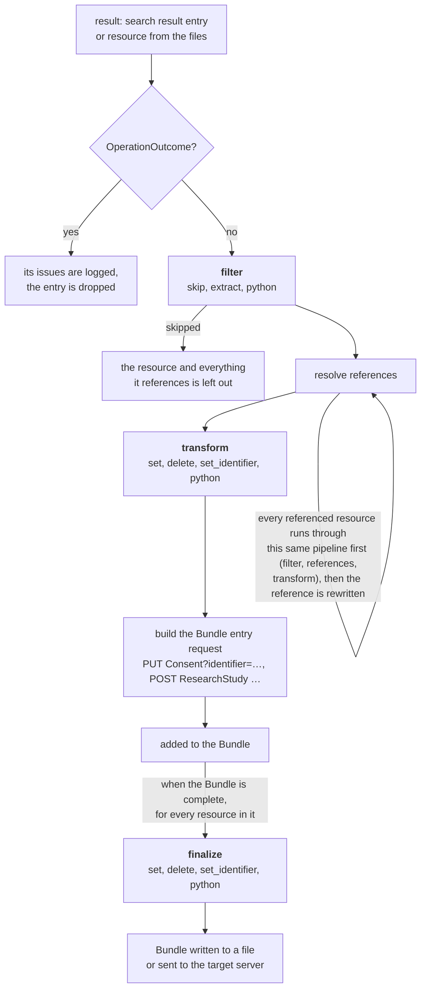

# Processing rules and the expression language

fhirsync copies FHIR resources from a source (a FHIR server or FHIR files) to a target. On the way, every resource can
be **filtered** and **changed** by rules. You configure the rules in the `processing.rules` section of the
configuration file (see [config-example.yaml](../config-example.yaml) and the [README](../README.md)).

This document explains:

1. [When rules run](#1-when-rules-run): the processing pipeline and its phases
2. [How rules are written](#2-how-rules-are-written): structure, order, phases
3. [The operations](#3-operations): `skip`, `extract`, `set`, `delete`, `set_identifier`, `python`
4. [The expression language](#4-the-expression-language): FHIRPath, variables, templates, element paths
5. [Validation and errors](#5-validation-and-errors)
6. [How rules interact with bundling](#6-how-rules-interact-with-bundling): identifiers, references, ids
7. [Cookbook](#7-cookbook): real world examples, each tested against real resources
8. [Limitations and pitfalls](#8-limitations-and-pitfalls)
9. [Quick reference](#9-quick-reference)

> **Without rules, no resource is changed.** fhirsync still searches the source, follows references, writes the
> Bundles and sends them, but every resource is passed through exactly as the source delivered it. This includes the
> resource `id` and `meta.lastUpdated` of the *source* server, which many target servers reject in conditional
> updates. Almost every configuration therefore needs at least the rule from
> [7.1](#71-the-minimal-rule-set-for-conditional-updates).


## 1. When rules run

For every result (a resource of a search result, or a resource from the files), fhirsync runs this pipeline:



What each phase is for:

| Phase | Runs | Typical use | Allowed operations |
|---|---|---|---|
| `filter` | before references are resolved | leave resources out, read values into variables | `skip`, `extract`, `python` |
| `transform` | after references are resolved and rewritten | change the resource for the target | `set`, `delete`, `set_identifier`, `python` |
| `finalize` | after the Bundle entry request was built | remove what the request needed but the target must not get, e.g. the source `id` | `set`, `delete`, `set_identifier`, `python` |

Why the phases matter:

- **Skipping must happen in `filter`.** A resource skipped there is left out together with everything it references:
  the references aren't even fetched. Skipping later would leave its referenced resources in the Bundle.
- **`transform` sees the rewritten references.** When it runs, references to other resources in the Bundle have
  already been rewritten to the conditional form `Patient?identifier=system|value` (with `reference_mode:
  identifier`).
- **`finalize` runs after the request was built.** The request URL can use the source `id` (`request.url: id`) or an
  identifier set in `transform`. Only afterwards does `finalize` remove the `id`, so the target never sees it.


## 2. How rules are written

```yaml
processing:
  identifier_systems:             # used by identifierSystem('<Type>') in rules
    Patient: http://hospital.example/sid/patient
  rules:
    "*":                          # rules for all resource types
      finalize:
        - delete: [id, meta.lastUpdated]
    Consent:                      # rules for Consent resources only
      filter:
        - skip: {when: "status != 'active'"}
      transform:
        - delete: patient.display
```

- **Keys** under `rules` are FHIR resource types (`Consent`, `Patient`, …) or `"*"` for all types. `"*"` must be
  quoted, because a bare `*` means something else in YAML.
- **Per resource type**, each phase (`filter`, `transform`, `finalize`) holds a list of rules. Phases you don't need
  are left out.
- **Each rule has exactly one operation**, e.g. `skip`, `set`, … A rule with two operations, or none, is an error.
- **Order:** in each phase, the `"*"` rules run first, then the rules of the resource type, each list from top to
  bottom. So general defaults go into `"*"`, and a resource type can override them.

> **YAML tip:** the short inline form `{path: patient.reference, value: …}` is handy, but in inline mappings a value
> that contains `[`, `{`, `,` or `#` must be quoted: `{path: "meta.profile[0]", value: …}`. In the normal block form
> (one key per line) only values starting with `{`, `[`, `*`, `&`, `!`, `%` or `@` need quotes. When in doubt, quote.


## 3. Operations

### 3.1 `skip`: leave a resource out (`filter`)

```yaml
- skip:
    when: "status != 'active'"     # optional FHIRPath condition
    log: warning                   # optional: warning (default), info or none
```

- **`when`** is a FHIRPath expression evaluated on the resource. The resource is skipped if the result is exactly
  `true`. An empty result, or `false`, keeps the resource.
- **Without `when`**, the resource is always skipped. That is useful to drop a whole resource type: write `- skip:`
  or `- skip: {}`.
- **`log`** controls the log level of the message `Consent/123 skipped by processing.rules.Consent.filter[0] (…)`.

A skipped resource is left out together with everything it references (see [1](#1-when-rules-run)). If it was
reached through a reference, that reference is **not rewritten** (see [8](#8-limitations-and-pitfalls)).

### 3.2 `extract`: read a value into a variable (`filter`)

```yaml
- extract:
    name: pat_id                     # variable name, used as %pat_id
    from: patient.display            # FHIRPath expression
    pattern: '^\s*\S+\s+(\d{10})\s*$'   # optional regular expression
    on_mismatch: skip                # skip (default), error or empty
```

1. **`from`** is evaluated on the resource. Its **first** result, converted to text, is the value.
2. **With a `pattern`**, a Python regular expression is searched in that value. The value becomes the first capture
   group, or the whole match if the pattern has no group. The pattern is *searched*, not matched in full, so anchor it
   with `^…$` if the whole value has to match.
3. **No value** (an empty `from` result, or a pattern that doesn't match) is handled by `on_mismatch`:
   - `skip`: log a warning and skip the resource
   - `error`: stop the whole run with an error
   - `empty`: continue with an empty string as the value

The variable can be used in all later rules of the same resource as `%name`: further `filter` rules and all
`transform` rules (see [4.3](#43-variables)).

> In YAML, write regular expressions in **single quotes**. Backslashes then need no escaping: `'^\d{10}$'`. In double
> quotes, every backslash would have to be doubled.

### 3.3 `set`: set an element (`transform`, `finalize`)

```yaml
- set:
    path: patient.reference          # element path (see 4.6)
    value: "Patient?identifier={identifierSystem('Patient')}|{%pat_id}"   # template (see 4.5) or literal value
```

- **`path`** names the element to set. Missing elements on the way are created, for example `meta` and the
  `meta.profile` list for `meta.profile[0]`.
- **A text `value` is a template**: parts in `{braces}` are FHIRPath expressions and are replaced by their result
  (see [4.5](#45-templates)).
- **Any other `value`** (a number, `true`/`false`, a YAML list or mapping) is set exactly as written. Text inside such
  a list or mapping is **not** treated as a template.

```yaml
- set: {path: active, value: true}                          # boolean
- set:                                                      # a whole element, as a YAML mapping
    path: "meta.tag[0]"
    value: {system: "http://hospital.example/cs/sync-source", code: gics, display: "Synced from gICS"}
```

### 3.4 `delete`: remove elements (`transform`, `finalize`)

```yaml
- delete: patient.display                        # one path
- delete: [id, meta.lastUpdated, meta.versionId, text]   # several paths
```

- **A path that doesn't exist** is ignored. That is not an error.
- **Deleting a list entry** (`identifier[1]`) moves the following entries up.

### 3.5 `set_identifier`: replace the identifiers (`transform`, `finalize`)

```yaml
- set_identifier:
    system: "{identifierSystem('Consent')}"      # template
    value: "{(organization[0].display + '+' + policy[0].uri + '+' + %pat_id).sha256()}"   # template
```

- **All existing identifiers are replaced** by this single one.
- **For resource types with only one identifier** (e.g. `Bundle`), the identifier is set as a single element.
- **A resource type without an `identifier` element** stops the run with an error.

To *keep* existing identifiers and add your own, use `set` with list indexes instead (see
[7.6](#76-keep-the-gics-identifier-of-a-researchstudy-and-add-your-own)).

### 3.6 `python`: your own code (all phases)

```yaml
- python: {function: "lab_mapping:map_local_codes"}      # module:function
```

- **The function** is called with two arguments: the resource as a Python `dict` (FHIR JSON) and the `dict` of
  variables. It returns the (changed) resource `dict`.
- **Returning `None`** skips the resource. That is only allowed in `filter`; in the other phases it stops the run with
  an error.
- **The module must be importable**: installed in the environment, or its directory on the `PYTHONPATH`.
- **Exceptions** in the function stop the run with an error that names the rule.

Use `python` for what the declarative operations can't do: lookups in mapping tables, logic depending on several
conditions, calls to other services. See [7.12](#712-map-local-codes-with-a-python-function).


## 4. The expression language

### 4.1 Where expressions are used

| Where | What it is | Result used |
|---|---|---|
| `skip.when` | a FHIRPath expression | skip if the result is `true` |
| `extract.from` | a FHIRPath expression | the first result, as text |
| `{…}` in `set.value`, `set_identifier.system`, `set_identifier.value` | a FHIRPath expression inside a template | the first result, as text |
| `set.path`, `delete` | an **element path**, *not* FHIRPath | see [4.6](#46-element-paths-in-set-and-delete) |
| `extract.pattern` | a Python regular expression | see [3.2](#32-extract-read-a-value-into-a-variable-filter) |

### 4.2 FHIRPath in a nutshell

[FHIRPath](https://hl7.org/fhirpath/) is the standard expression language of FHIR, used for example in profiles and
search parameters. fhirsync evaluates it with [fhirpathpy](https://github.com/beda-software/fhirpath-py) on the
resource's JSON, using the FHIR R4 model. Expressions always start at the resource itself, so you write
`patient.display`, not `Consent.patient.display`.

**Everything is a collection.** Every expression returns a list of values, possibly empty. `patient.display` on a
Consent returns `['Pseudonym 1000000001']`. `category.coding.code` returns the codes of *all* categories:
`['57016-8', 'consent-status', '2.16.840.1.113883.3.1937.777.24.2.184']`. An element that doesn't exist returns an
empty collection, **not** an error.

**Navigating**

| Expression (on a gICS Consent) | Result |
|---|---|
| `status` | `['active']` |
| `patient.display` | `['Pseudonym 1000000001']` |
| `organization[0].display` | `['MII']` (index, counting from 0) |
| `organization.first().display` | `['MII']` |
| `policy.uri` | `['2.16.840.1.113883.3.1937.777.24.2.184']` |
| `category.coding.code` | all three category codes |
| `provision.provision.count()` | `[27]` |

**Filtering with `where`**: keeps the entries for which the condition is true:

| Expression | Result |
|---|---|
| `identifier.where(system = 'https://ths-greifswald.de/fhir/gics/identifiers/Pseudonym').value` (gICS Patient) | `['1000000001']` |
| `provision.provision.where(type = 'permit').count()` (Consent) | `[15]` |
| `code.coding.where(system = 'http://loinc.org').code.first()` (Observation) | `['718-7']` |

**Conditions**: for `skip.when` and `iif`:

| Expression | Meaning |
|---|---|
| `status = 'active'`, `status != 'active'` | equal / not equal |
| `exists()`, `exists().not()`, `empty()` | something is (not) there |
| `category.coding.where(system = 'http://loinc.org' and code = '57016-8').exists()` | a specific coding is present |
| `gender in ('female' \| 'male')` | value is one of a list (`\|` combines collections) |
| `a and b`, `a or b`, `a.not()` | logic |
| `valueQuantity.value > 10` | comparing numbers, dates and text |

**Text functions** (tested results):

| Expression | Result |
|---|---|
| `patient.display.substring(10)` | `['1000000001']` (from position 10) |
| `birthDate.toString().substring(0, 4)` | `['1980']` (start, length) |
| `patient.display.replace('Pseudonym ', '')` | `['1000000001']` |
| `patient.display.startsWith('Pseudonym')`, `.endsWith(…)`, `.contains(…)` | `[True]` |
| `patient.display.matches('^Pseudonym [0-9]{10}$')` | `[True]` (regular expression) |
| `patient.display.split(' ')` | `['Pseudonym', '1000000001']` |
| `name.family.upper()`, `.lower()`, `.trim()`, `.length()` | `['MUSTER']`, … |
| `subject.reference.replace('Patient/', '')` | `['p-4711']` |

**Conversions and choice elements**

| Expression | Result |
|---|---|
| `valueQuantity.value.toString()` | `['13.2']` |
| `identifier.value.toInteger()` | `[12345]` for `'0012345'` |
| `dateTime.toString().substring(0, 10)` | `['2026-10-14']` (date part of a dateTime) |
| `value.ofType(Quantity).value` | `[13.2]`: choice elements (`value[x]`) are addressed by their base name plus `ofType` |
| `effective.ofType(dateTime)` | `['2026-03-01T10:00:00+01:00']` |
| `valueQuantity.value`, `effectiveDateTime` | the same, using the concrete JSON names |
| `extension('http://fhir.de/ConsentManagement/StructureDefinition/DomainReference').extension('domain').value.reference` | `['ResearchStudy/468b…']`: extensions by URL |

**Choosing a value: `iif(condition, then, else)`**

| Expression | Result |
|---|---|
| `iif(status = 'active', 'aktiv', 'inaktiv')` | `['aktiv']` |
| `iif(code.coding.where(system = 'http://loinc.org').exists(), 'loinc-coded', 'local-code')` | depends on the resource |

**Date functions**: `today()` gives `['2026-10-15']` and `now()` the current date and time, at the time the rule
runs.

**Joining text: `&` versus `+`.** This difference matters in templates:

| Expression | Result if `name.prefix` doesn't exist |
|---|---|
| `name.family & '-' & name.prefix` | `['Muster-']`: `&` treats a missing value as empty text |
| `name.family + '-' + name.prefix` | `[]`: `+` gives *nothing* if any part is missing |

Use `+` when every part is required, e.g. for identifiers, so a missing part becomes an error (see
[4.5](#45-templates)). Use `&` when parts are optional.

The full language is described in the [FHIRPath specification](https://hl7.org/fhirpath/). fhirpathpy implements
nearly all of it.

### 4.3 Variables

- **Values extracted with `extract`** are available as `%name`, e.g. `%pat_id`.
- **Variables belong to one resource.** They are set in its `filter` phase, and used in its later `filter` rules and
  its `transform` rules.
- **Variables are not shared:** a Consent's variables aren't visible while its referenced ResearchStudy is processed,
  and the other way round.
- **Variables are not available in `finalize`**, which runs later for the whole Bundle. Using one there is an error
  at startup.
- **A variable used before the rule that sets it** is an error. When the configuration is loaded, fhirsync checks
  that every `%name` is set by an `extract` in a `filter` rule of the same resource type, or of `"*"`. It doesn't
  check the order within the `filter` phase, though: using a variable in a `filter` rule *above* its `extract` fails
  only when the rule runs.

### 4.4 fhirsync functions

| Function | Result | Example |
|---|---|---|
| `identifierSystem('<Type>')` | the system configured in `processing.identifier_systems` for that type | `identifierSystem('Patient')` gives `'http://hospital.example/sid/patient'` |
| `sha256()` | the SHA-256 hash (64 hexadecimal characters) of each input value | `(organization[0].display + '+' + policy[0].uri + '+' + %pat_id).sha256()` |

`identifierSystem` with a type that isn't configured is an error when the configuration is loaded. Keeping the
systems in one place means you change a system once, not in every rule.

### 4.5 Templates

Text values of `set.value`, `set_identifier.system` and `set_identifier.value` are **templates**. Every part in
`{braces}` is a FHIRPath expression and is replaced by its result. The rest is copied as written:

```yaml
- set:
    path: patient.reference
    value: "Patient?identifier={identifierSystem('Patient')}|{%pat_id}"
    # → Patient?identifier=http://hospital.example/sid/patient|1000000001
```

Rules for templates:

- **Only the first result** of an expression is used. `{category.coding.code}` gives `57016-8`; the other codes are
  ignored. Use `where(…)` or `first()` to say which one you mean.
- **An expression without a result stops the run** with an error that names the rule and the resource, e.g.
  `processing.rules.Consent.transform[0]: '{organization[3].display}' gives no value for Consent/4d83…`. This is
  intended: an identifier built from a missing value would silently be wrong. For optional parts, give an alternative
  with `iif(x.exists(), x, 'none')`, or use `&` inside one expression.
- **Results are written as text:** numbers like `13.2`, dates as in the resource.
- **Booleans are written as `True` and `False`**, not FHIR's `true`/`false`, because of the FHIRPath library. Write
  `{iif(active, 'true', 'false')}` when you need the FHIR spelling in text.
- **Literal braces** are written doubled: `"{{not a template}}"` gives `{not a template}`.
- **Results are converted to the element's type.** After the rules of a phase, the resource is converted to its FHIR
  types, so a template result also works for elements that aren't text: `false` (or `False`) sets a boolean element,
  `13.2` a decimal. The conversion is lenient: `yes` and `1` also count as `true` for a boolean. Text that can't be
  converted, like `maybe` for a boolean or `abc` for a decimal, stops the run. For fixed values, a literal is clearer:
  `value: false`.

### 4.6 Element paths in `set` and `delete`

`set.path` and `delete` use a simple **element path**, not FHIRPath, because FHIRPath can only read:

| Path | Meaning |
|---|---|
| `status` | the element `status` |
| `patient.reference` | `reference` inside `patient` |
| `meta.profile[0]` | the first entry of the list `meta.profile` |
| `identifier[1].system` | `system` of the second identifier |

Rules for element paths:

- **Names** are the JSON names of the elements, including choice elements: `valueQuantity`, not `value`.
- **Missing elements** on the way are created when setting.
- **An index equal to the current length of the list appends** a new entry. `meta.profile[0]` on a resource without
  profiles creates the list with one entry; on a resource with one profile it replaces that profile.
- **An index beyond the end** (`meta.profile[5]` with one profile) is an error.
- **No `where`, `first()` or other functions** are allowed: the path must name exactly one place.
- **After all rules of a phase**, the resource is checked against the FHIR model. A `set` that creates an invalid
  resource (an unknown element, a malformed date) stops the run with an error that names the resource and the
  problem.


## 5. Validation and errors

**When the configuration is loaded**, fhirsync checks the rules and stops with a list of all problems found. Every
problem names its location, e.g. `processing.rules.Consent.transform[1]`. These are checked:

- **The rule structure:** unknown phases and operations (with a suggestion for typos), exactly one operation per rule,
  operations allowed in their phase
- **Element paths, regular expressions and variable names**
- **FHIRPath expressions:** unknown functions, wrong numbers of arguments, undefined `%variables`, and
  `identifierSystem` with a type that isn't configured

Example:

```
Invalid configuration in config.yaml:
  processing.rules.Consent: filter[0]: set is not allowed in phase filter, allowed are skip, extract, python
```

Some malformed FHIRPath expressions are accepted without any error, because the FHIRPath library reads them
leniently: `name..family` is evaluated like `name.family`. Try new rules with `target.mode: file` before using them
against a server.

**While running**, every problem with a rule **stops the run**, with an error that names the rule and the resource:

- a template expression without a result
- `extract` with `on_mismatch: error`
- a resource that is invalid after a phase
- an exception in a `python` function

Stopping is deliberate: a rule that doesn't do what it should would otherwise write wrong data to the target.


## 6. How rules interact with bundling

Some settings in `bundling.resources` depend on what the rules produce.

### Identifiers are required for identifier-based requests

With `request.url: identifier` (the default), every resource in the Bundle is written with a conditional request
like `PUT Consent?identifier=<system>|<value>`. That needs an identifier:

> **A resource without an identifier stops the whole run** with `Resource Consent/… has no identifier.` This is
> intended, so that no resource is ever written to the target without a stable identity.

- **Resources without identifiers** at the source must get one by a rule. For example, gICS `consent-status` Consents
  get theirs only through a `set_identifier` rule (see [7.2](#72-a-complete-rule-set-gics-consents)).
- **Otherwise,** use `request.url: id` or `method: post` for that type.

### The first identifier is the one that counts

The request URL (`PUT Type?identifier=…`), the `ifNoneExist` condition of `post`, and rewritten references all use
the **first** identifier of a resource. With several identifiers, make sure the one the target uses for matching
comes first (see [7.6](#76-keep-the-gics-identifier-of-a-researchstudy-and-add-your-own)), or configure its system as
`bundling.resources.<Type>.identifier_system`: then the identifier with that system counts, wherever it is (README
settings reference).

### References are rewritten before `transform`

With `reference_mode: identifier`, a reference to a resource that is included in the Bundle is rewritten to that
resource's identifier that counts (the first one, or the one of `identifier_system`): `ResearchStudy/468b…` becomes
`ResearchStudy?identifier=<system>|<value>`.
- The identifier is taken **after** the referenced resource's `transform` rules, so identifiers set by rules are used.
- References to types in `ignore_references_to` are **not followed and not rewritten**. They keep pointing to the
  source server's ids. If the target needs them, set them with a rule, as the gICS rules do for `patient.reference`.

### The source `id` must be removed in `finalize`

The source server's `id` stays in the resource until the `finalize` phase, because `request.url: id` needs it. If it
reached the target, a conditional `PUT Type?identifier=…` whose body contains a different `id` is rejected by many
servers. Remove it with:

```yaml
"*":
  finalize:
    - delete: [id, meta.lastUpdated]
```


## 7. Cookbook

All examples were run against real resources: a gICS 2026.1.1 `consent-status` Consent with its ResearchStudy and
Patient, and realistic Patient and Observation resources. They use these identifier systems:

```yaml
processing:
  identifier_systems:
    Patient: http://hospital.example/sid/patient
    Consent: http://hospital.example/sid/consent
    ResearchStudy: http://hospital.example/sid/consentSource
    Observation: http://hospital.example/sid/observation
```

### 7.1 The minimal rule set for conditional updates

**Task:** sync resources unchanged, with `PUT Type?identifier=…` requests.

```yaml
rules:
  "*":
    finalize:
      - delete: [id, meta.lastUpdated]
```

**Result:** the resource keeps all its content. `id` and `meta.lastUpdated` of the source server are removed after the
request was built. `meta.versionId` and other metadata stay; see [7.8](#78-remove-narrative-and-source-metadata).

### 7.2 A complete rule set: gICS consents

[config-example.yaml](../config-example.yaml) contains a complete rule set: syncing the `consent-status` Consents of
gICS to a FHIR server where the patients already exist with a hospital identifier. It combines `extract`, `set`,
`set_identifier` and `delete` with a stable identifier from content, and reproduces the processing that was built into
fhirsync 0.7 and older. Its tests are in `tests/cookbook/` and `tests/bundling/`, on a recorded gICS search.

### 7.3 Skip resources by status

**Task:** only sync active Consents, and never Observations entered in error.

```yaml
rules:
  Consent:
    filter:
      - skip: {when: "status != 'active'"}
  Observation:
    filter:
      - skip: {when: "status = 'entered-in-error'", log: info}
```

**Result:** an `inactive` Consent is skipped with the warning
`Consent/4d83… skipped by processing.rules.Consent.filter[0] (status != 'active')`. Active Consents pass unchanged.
Erroneous Observations are skipped with an `info` message.

### 7.4 Skip test patients

**Task:** leave out test patients, whose hospital number starts with `99`.

```yaml
rules:
  Patient:
    filter:
      - skip:
          when: "identifier.where(system = 'http://hospital.example/sid/mrn').value.startsWith('99')"
```

**Result:** the Patient with hospital number `9900001` is skipped, the one with `0012345` passes. Resources that
reference a skipped Patient keep their reference unchanged (see [8](#8-limitations-and-pitfalls)), so skip those as
well if needed.

### 7.5 Use the pseudonym identifier instead of the display value

**Task:** for a Patient from gICS, take the pseudonym from its identifier rather than from a display text, and use
it as the hospital identifier.

```yaml
rules:
  Patient:
    filter:
      - extract:
          name: psn
          from: "identifier.where(system = 'https://ths-greifswald.de/fhir/gics/identifiers/Pseudonym').value"
          pattern: '^\d{10}$'
    transform:
      - set_identifier:
          system: "{identifierSystem('Patient')}"
          value: "{%psn}"
```

**Result:** variables `{'psn': '1000000001'}`, and the identifier becomes
`[{"system": "http://hospital.example/sid/patient", "value": "1000000001"}]`.

### 7.6 Keep the gICS identifier of a ResearchStudy and add your own

**Task:** gICS's ResearchStudy already has the stable identifier `https://ths-greifswald.de/fhir/gics/|MII`. Keep it,
but put your own identifier *first*, because the first one is used for requests and references (see
[6](#6-how-rules-interact-with-bundling)).

```yaml
rules:
  ResearchStudy:
    transform:
      # copy gICS's identifier to the second position, then overwrite the first one
      - set: {path: "identifier[1].system", value: "{identifier[0].system}"}
      - set: {path: "identifier[1].value", value: "{identifier[0].value}"}
      - set: {path: "identifier[0].system", value: "{identifierSystem('ResearchStudy')}"}
      - set: {path: "identifier[0].value", value: "{id}"}
```

**Result:**

```json
"identifier": [{"system": "http://hospital.example/sid/consentSource", "value": "468b895a-c809-11f1-8d48-d6456abb6135"},
               {"system": "https://ths-greifswald.de/fhir/gics/", "value": "MII"}]
```

The order of the rules matters: the copy must happen before the first identifier is overwritten. This works because
gICS always delivers exactly one identifier. With an unknown number of identifiers, use a `python` function.

### 7.7 Tag synced resources

**Task:** mark every synced resource with a fixed tag and the date of the sync.

```yaml
rules:
  "*":
    transform:
      - set:
          path: "meta.tag[0]"
          value: {system: "http://hospital.example/cs/sync-source", code: gics, display: "Synced from gICS"}
      - set: {path: "meta.tag[1].system", value: "http://hospital.example/cs/sync-date"}
      - set: {path: "meta.tag[1].code", value: "{today()}"}
```

**Result:**

```json
"tag": [{"system": "http://hospital.example/cs/sync-source", "code": "gics", "display": "Synced from gICS"},
        {"system": "http://hospital.example/cs/sync-date", "code": "2026-10-15"}]
```

The first tag is a literal YAML mapping and is set as written. The second is built from two templates. If the source
resources can already carry tags, use higher indexes or a `python` function, because `meta.tag[0]` *replaces* the
first existing tag.

### 7.8 Remove narrative and source metadata

**Task:** the target generates its own narrative and versions. Remove everything that belongs to the source.

```yaml
rules:
  "*":
    finalize:
      - delete: [id, meta.lastUpdated, meta.versionId, text]
```

**Result:** `id`, `text`, `meta.versionId` and `meta.lastUpdated` are gone. An empty `meta` is left as `{}`, which is
valid.

### 7.9 A stable identifier from a natural key

**Task:** Observations from the source have no identifier, but each one is uniquely described by patient, LOINC code
and time. Build an identifier from that, so repeated syncs update the same Observation.

```yaml
rules:
  Observation:
    transform:
      - set_identifier:
          system: "{identifierSystem('Observation')}"
          value: "{(subject.reference + '|' + code.coding.where(system = 'http://loinc.org').code.first() + '|' + effective.ofType(dateTime).toString()).sha256()}"
```

**Result:** `[{"system": "http://hospital.example/sid/observation", "value": "42f28ceb…d4b4f837"}]`.

`+` is used deliberately: if any part of the key is missing, the template has no result and the run stops, instead
of producing an identifier that collides with other Observations. Note that `subject.reference` has already been
rewritten in `transform` if the Patient is in the Bundle (see [6](#6-how-rules-interact-with-bundling)). That is
stable as long as the Patient's identifier is.

### 7.10 Pseudonymise patients for a research target

**Task:** replace the hospital number by a salted hash, remove name, contact data and address, and keep only the
birth year.

```yaml
rules:
  Patient:
    filter:
      - extract:
          name: mrn
          from: "identifier.where(system = 'http://hospital.example/sid/mrn').value"
          on_mismatch: error
    transform:
      - set_identifier:
          system: "{identifierSystem('Patient')}"
          value: "{('my-secret-salt|' + %mrn).sha256()}"
      - delete: [name, telecom, address, text]
      - set: {path: birthDate, value: "{birthDate.toString().substring(0, 4)}"}
```

**Result:** the identifier `d32b0211…f72b45e09`, no `name`, `telecom`, `address` or `text`, `birthDate: "1980"`, and
`gender` kept.

> This shows the mechanics, not a complete anonymisation concept. Which elements must be removed or coarsened depends
> on your data protection concept. Keep the salt secret, e.g. by passing it in through an environment variable in the
> configuration file.

### 7.11 Conditional values

There is no conditional `set`; every rule applies to every resource of its type. Use `iif` to choose the *value*:

```yaml
rules:
  Observation:
    transform:
      - set: {path: "meta.tag[0].system", value: "http://hospital.example/cs/coding-status"}
      - set:
          path: "meta.tag[0].code"
          value: "{iif(code.coding.where(system = 'http://loinc.org').exists(), 'loinc-coded', 'local-code')}"
```

**Result:** an Observation with only a local code gets the tag code `local-code`, one with a LOINC code gets
`loinc-coded`. To decide whether something is set *at all*, use a `python` function.

`extract` with `on_mismatch: empty` combines well with `iif`, for example to mark Consents without a valid patient id
instead of skipping them:

```yaml
rules:
  Consent:
    filter:
      - extract: {name: pat_id, from: patient.display, pattern: '(\d{10})$', on_mismatch: empty}
    transform:
      - set: {path: "meta.tag[0].system", value: "http://hospital.example/cs/patient-id-check"}
      - set: {path: "meta.tag[0].code", value: "{iif(%pat_id = '', 'missing', 'ok')}"}
```

### 7.12 Map local codes with a Python function

**Task:** the laboratory system sends local codes. Add the LOINC code from a mapping table, and leave out
Observations whose code isn't mapped.

`lab_mapping.py`, importable (e.g. next to the configuration, with that directory on the `PYTHONPATH`):

```python
"""Map local laboratory codes to LOINC, skip Observations without a mapping."""
LOINC = {"HB": ("718-7", "Hemoglobin"), "LEUKO": ("6690-2", "Leukocytes")}


def map_local_codes(resource, variables):
    coding = resource["code"]["coding"][0]
    if coding["system"] != "http://hospital.example/cs/lab":
        return resource
    if coding["code"] not in LOINC:
        return None  # skip: no LOINC mapping
    code, display = LOINC[coding["code"]]
    resource["code"]["coding"].insert(0, {"system": "http://loinc.org", "code": code, "display": display})
    return resource
```

```yaml
rules:
  Observation:
    filter:
      - python: {function: "lab_mapping:map_local_codes"}
```

**Result:** `HB` becomes `[{"system": "http://loinc.org", "code": "718-7", "display": "Hemoglobin"}, {…local HB…}]`,
and an Observation with code `XYZ` is skipped. The function runs in `filter`, because only there may it skip
resources, and so that later rules already see the LOINC code.

### 7.13 Read a value from a reference

```yaml
rules:
  Observation:
    filter:
      - extract: {name: patient_id, from: subject.reference, pattern: '^Patient/(.+)$'}
    transform:
      - set: {path: "note[0].text", value: "Source patient {%patient_id}"}
```

**Result:** `note: [{"text": "Source patient p-4711"}]`. `filter` runs before references are rewritten, so it still
sees the source's `Patient/p-4711`.


## 8. Limitations and pitfalls

- **No conditional `set` or `delete`.** Choose values with `iif` ([7.11](#711-conditional-values)), or use `python`.
- **No "append to list".** `meta.profile[1]` appends only if the list has exactly one entry; an index beyond the end
  is an error. For lists of unknown length, use `python`.
- **Only the first result** of an expression is used in templates and `extract`.
- **Booleans render as `True`/`False`** in templates. Use `iif(x, 'true', 'false')`.
- **`+` with a missing part gives no result** (and in a template stops the run). `&` treats missing parts as empty.
- **A skipped referenced resource leaves the reference unchanged.** If a Consent references a Patient that a `filter`
  rule skips, the Consent still points to `Patient/<source id>`. Skip the referencing resources too, or set the
  reference by a rule.
- **References with a search URL** (`Patient?identifier=…`) at the *source* are not supported correctly yet: fhirsync
  fetches them by search, and processes the result pages instead of the found resources. gICS only uses `Type/id`
  references, which work.
- **References that aren't `Type/id` or `Type?…`** (absolute URLs, `#contained`) are not followed. An error is
  logged.
- **Variables are not available in `finalize`**, nor in the rules of referenced resources.
- **Some malformed FHIRPath expressions are accepted** and read leniently: `name..family` works like `name.family`.
- **`set_identifier` replaces all identifiers.** To keep them, see [7.6](#76-keep-the-gics-identifier-of-a-researchstudy-and-add-your-own).


## 9. Quick reference

```yaml
processing:
  identifier_systems: {<Type>: <system>, …}
  rules:
    "<Type>" | "*":
      filter:
        - skip: {when: "<FHIRPath>", log: warning|info|none}        # when optional: always skip
        - extract: {name: <var>, from: "<FHIRPath>", pattern: '<regex>', on_mismatch: skip|error|empty}
        - python: {function: "<module>:<function>"}
      transform:                                                     # finalize: the same operations
        - set: {path: <element path>, value: "<template>" | <literal>}
        - delete: <element path> | [<element path>, …]
        - set_identifier: {system: "<template>", value: "<template>"}
        - python: {function: "<module>:<function>"}
```

| | |
|---|---|
| Order | `"*"` rules first, then the type's rules, top to bottom |
| FHIRPath | `when`, `from`, and `{…}` in templates; evaluated on the resource |
| Variables | `%name`, set by `extract`, used in the same resource's filter and transform rules |
| Functions | `identifierSystem('<Type>')`, `sha256()`, plus all FHIRPath functions |
| Templates | `{…}` replaced by the first result as text; no result stops the run; `{{`/`}}` for literal braces |
| Element paths | `a.b[0].c`, JSON names, missing elements are created, index = length appends |
| Errors | invalid rules stop at startup, failing rules stop the run |
| Without rules | resources are synced unchanged, including the source `id` |
